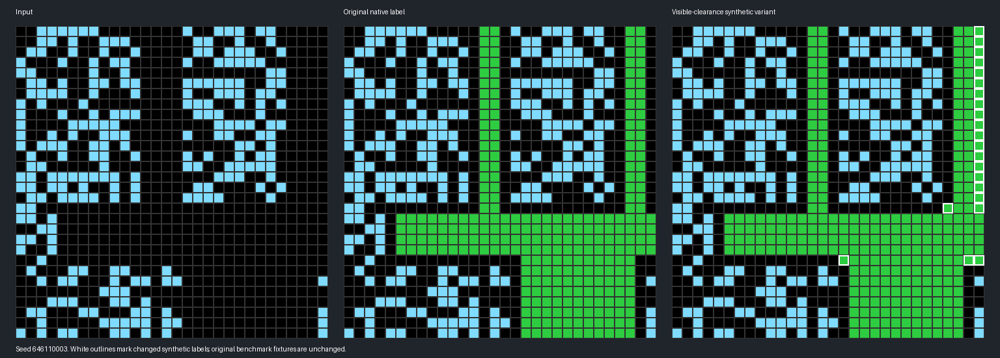

# a64e4611: explicit visible-clearance synthetic variant

The admitted program solves the unchanged original demonstration/query fixtures and an explicitly versioned synthetic variant, **`a64e4611-visible-clearance-v1`**. It does **not** establish that the archived ARC-GEN hidden-rectangle constructor is solved for arbitrary native samples. Its certificate and every exported program/grid record state `native_equivalent: false`.

## Why a variant is necessary

The native constructor paints hidden rectangle interiors, then removes green from the input. Random background gaps can conceal multiple valid rectangle layouts with different outputs. `a64e4611-native-twin-witnesses.json` preserves concrete identical-input/different-label examples. Requiring an output recoverable from visible cells is a different synthetic definition, not merely a corrected tie.

The installed constructor preserves the original input sampler and RNG sequence. It labels those inputs by a declared rule: paint long safe horizontal/vertical runs with a one-cell obstacle clearance, then remove short exposed dead ends. Its parameters are minimum run 12 and maximum pruned run 3. The original constructor is archived at `arc_agi2/archives/task_a64e4611_native_06ef672f.py`, hash `06ef672f20c070afad1b44e08eedfa842f2d181632fd9f050f36e17873d34bc2`.

These parameters are not claimed uniquely implied by the benchmark. Twenty parameter settings fit the original demonstrations. Accordingly, the **program target tests all 930 combinations** of minimum run 1–30 and pruning limit 0–30, keeps those matching all demonstrations, and answers only when every survivor gives the same query output. It never prefers 12/3. A separate NumPy implementation enforces this condition before exporting an episode.

## Evidence

| Check | Result |
|---|---:|
| Unchanged original fixture contexts, D4 and palette variants | 16 passed |
| Fresh retained pair inputs | 1,000 distinct |
| Fresh pair checks across D4 | 8,000 passed |
| Independent episode evidence checks | 250 passed |
| Query inputs retained | 250 / 250 |
| Demonstration-context retries | 512; maximum 23 per query |
| Sampler draws, including discarded contexts | 2,536 |
| Synthetic labels differing from archived native labels | 1,372 / 2,536 |
| Portable hypothesis tests | 8 passed |
| Installed integration checks | 4 passed |

The query is fixed before resampling context. Retry decisions use only demonstrations and query input, never the query answer. No query was discarded in this audit. An ambiguous episode remains a retry/shortfall rather than being assigned a convenient answer.

The original native sampler remains 30×30 by default. This audit makes no claim about expanded size support, all possible unseen scenes, or recovery of the uniquely intended ARC rule.

## Reproduce

From `hypothesis-audit-bundle`, run:

```bash
AUDIT_WORKERS=32 python run_audit.py
python -m unittest test_hypotheses -v
```

NumPy is the only external dependency used by the independent gate. The audit archive contains retained episodes and rejected demonstration contexts. From the repository root, run the installed checks with:

```bash
python -m unittest arc_agi2.test_a64e4611_variant -v
```

The first installed test initially compared ordered demo lists; the upstream constructor and saved reference use different demonstration ordering. The corrected check compares exact pair content within each split. Both the initial log and correction rerun are retained. No fixture values were edited to make the test pass.


